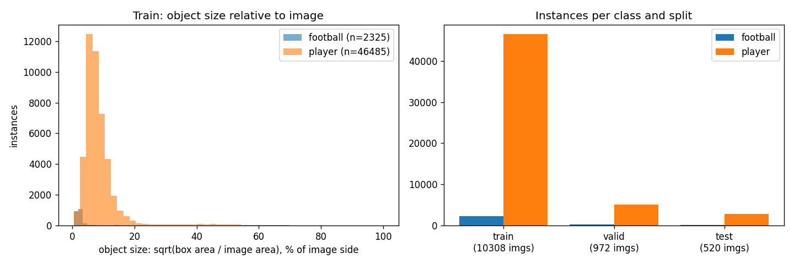
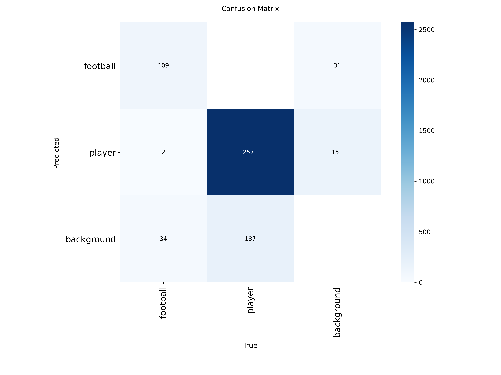
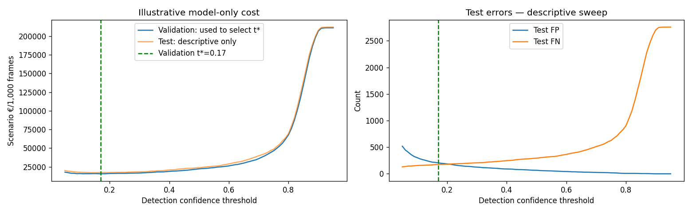

# Assignment 2 Report

- **Name**: Matias Arevalo
- **Student ID**: 19319
- **Email**: marevalo.ieu2022@student.ie.edu
- **Group**: BBADBA 5A

## Business problem, and the cost of being wrong

Grassroots and amateur football has no access to VAR or semi-automated offside technology. The professional systems depend on calibrated multi-camera rigs and dedicated operators, while most amateur clubs can at best film a match on a phone. The long-term goal of this project is a **foundational player-detection model for amateur football that makes assisted offside review possible at grassroots level**. Every later step of such a tool starts from knowing where each player is in the frame: who is attacking or defending, where the second-last defender stands, and where a line would go.

This assignment builds and costs that first component. The decision the model supports is: **for a candidate frame, which player detections can be accepted automatically, and which must a person confirm before they are used?** The people acting on it are a club analyst, coach or volunteer reviewing recorded match frames, and in a later, separately validated version an official using it as an aid. The model does not decide offside.

The positive class is `player`. `football` is trained and evaluated separately because ball position will matter later for the moment of the pass, but it is not costed.

### How it would work in amateur football

A **candidate frame** is a key moment where offside matters: a goal, a disputed flag, or an incident a coach or referee wants checked. The costing assumes about six per match. The tool does not need to analyse all 90 minutes; it prepares these few frames so they can be judged.

The intended workflow has two review steps, done by different people:

1. **Detection review (built and costed in this assignment).** The model pre-annotates the frame with player boxes. A trained volunteer or club analyst confirms or rejects the proposed boxes, in about 15 seconds. This is data preparation, not a refereeing decision, so it does not need a qualified official.
2. **Decision review (future components).** The referee, an assistant referee or a league official receives the verified frame and makes the offside call. By then the frame also carries team identity and an offside line from later components. The decision always stays with the official; the tool supplies the evidence.

Splitting the work this way keeps the scarcest and most expensive person, the official, away from low-skill checking. The official judges a frame that is already prepared instead of having to find every player first. That is what makes the idea affordable for grassroots competitions, which rely on volunteers and cannot staff a VAR team.

There is a direct precedent. FIFA's **Football Video Support (FVS)** is a video-review system for competitions that cannot run VAR. It works with one to four cameras, and a review is triggered by a head coach's challenge (two per team per match). It covers goal/no-goal decisions, which is where an offside in the build-up is checked, as well as penalties, direct red cards and mistaken identity. FIFA trialled it at youth level, and IFAB has expanded the trial ([FIFA](https://inside.fifa.com/innovation/news/what-is-football-video-support), [Inside World Football](https://insideworldfootball.com/?p=157369)). FVS shows that football's governing bodies want video review below the professional level with few cameras. This project targets the piece such a review still needs for offside, automatically located players, starting from ordinary cameras. Combined with a challenge mechanism like FVS, the volunteer-then-official workflow above could give an amateur ground a practical offside review.

| Error | What happens | Cost |
| --- | --- | --- |
| False negative: a labelled player is missed | The player disappears from the frame's representation. In the eventual offside tool, a missing attacker or second-last defender makes any positional comparison built on top unreliable. A reviewer who confirms boxes has nothing to look at, so the miss tends to go unnoticed. | **€40** per missed player |
| False positive: a box with no matching player (spectator, steward, duplicate box) | An extra candidate appears. It is visible, so a reviewer can reject it in seconds. Left alone, it can still distort later analysis. | **€10** per false box |
| True positive | Correct detection; no extra penalty. Compute and operating costs are excluded. | €0 |
| True negative | Not defined for detection: there is no countable set of "non-player" objects. | — |

The 4:1 ratio expresses the asymmetry. A missed player is worse than a false box because it is invisible and cannot be recovered downstream, while a false box is visible and cheap to reject. The euro values are planning assumptions that encode this asymmetry, not measured losses; the sensitivity analysis below shows what changes when they move. The asymmetry drives the later choices: a low confidence threshold that favours recall, a 960-pixel input to keep small and distant objects visible, and a review band where a person confirms uncertain players instead of the model discarding them.

## Dataset

- **Roboflow Universe:** workspace `augmented-startups`, project `football-player-detection-kucab`, **version 8**: <https://universe.roboflow.com/augmented-startups/football-player-detection-kucab>. It is public and used as is, not forked. The version is fixed in `train.ipynb`, and `outputs/dataset_manifest.json` records SHA-256 hashes of every image and label (fingerprint `1ac4a89c…abc5e0`).
- **Task and classes:** object detection with 2 classes, `football` and `player`.
- **What one image is:** a 1280×1280 frame, or crop of a frame, from televised professional football. It may be a wide tactical view, a close-up or a crowd-heavy shot, some with broadcaster logos (see `outputs/sample_predictions.png`).
- **Why it serves the problem:** it labels the two things an offside aid needs first, every player and the ball, with bounding boxes in real match situations: occlusion, crowding, distant players and players at the frame edge.
- **Where it falls short:** it is professional broadcast footage, not amateur phone video. It has no team identity, pitch calibration or pass timing. It teaches the model what a player on a pitch looks like, but the results below say nothing yet about amateur footage.

## What the dataset's composition implies

| Split | Images | Images with no labels | Player boxes | Football boxes | Players / image | Balls / image | Median player size* | Median ball size* |
| --- | --- | --- | --- | --- | --- | --- | --- | --- |
| train | 10,308 (87%) | 623 | 46,485 | 2,325 | 4.51 | 0.23 | 7.3% | 2.1% |
| valid | 972 (8%) | 30 | 5,132 | 275 | 5.28 | 0.28 | 6.0% | 1.9% |
| test | 520 (4%) | 23 | 2,758 | 145 | 5.30 | 0.28 | 6.0% | 1.9% |

\*Side of a square with the box's area, as a percentage of the image side (`outputs/dataset_description.json`). No identical image appears in two splits (hash check: 0 overlaps).

What follows from this:

1. **Players are about 20 times more frequent than balls.** Player results rest on 2,758 test boxes, so test recall is precise to roughly ±1 percentage point. Football results rest on only 145 test boxes: each ball moves recall by 0.7 points, and the 95% interval on football recall is roughly ±7 points. The football numbers are indicative; the player numbers can be trusted.
2. **The ball is tiny.** At a median of about 2% of the image side, it is roughly 24–27 pixels across at native 1280 px, about 20 at 960 and about 13 at the default 640. That is why I trained at 960 rather than 640, and it is also why ball localisation is the weakest result (football mAP50-95 0.41).
3. **Frames show part of the pitch.** About five labelled players per image, against 22 on the pitch, means most frames do not contain everyone. For offside, the second-last defender may simply be out of shot. A frame-level detector cannot fix that; a real tool needs camera coverage of the whole relevant area.
4. **Validation and test are harder than train, not easier.** They are more crowded and have smaller objects, so the test score is not flattered by easy images.
5. **What I cannot conclude.** Every split is broadcast footage, so nothing here measures performance on amateur pitches, phone cameras, lighting or kits. Exact duplicates are excluded, but neighbouring frames from the same match can still sit in train and test, so the scores may be optimistic. Match-level independence is unverified.

## Finetuning and baselines

**Model and task.** Object detection, because the decision needs the location of each player, not just whether a frame contains one. I fine-tuned **YOLO11s**, the larger of the two allowed sizes (9.4M parameters, 21.4 GFLOPs), from COCO-pretrained `yolo11s.pt`.

**Where and how it was trained.** Google Colab free tier on a Tesla T4, with Ultralytics 8.4.191 and PyTorch 2.11 (`outputs/environment.json`, `outputs/training_settings.json`). Settings: **40 epochs, image size 960, batch 16**, AdamW (auto-selected, lr0 0.001667), patience 15, mosaic off for the last 10 epochs, seed 0, deterministic. One epoch took about six minutes. The free runtime ended sessions after roughly ten epochs, so training ran over several sessions, each resumed from the saved `last.pt`; the final session (epochs 31–40) took 59 minutes. The run folder from earlier sessions was lost, so the historical `best.pt` was not available. The committed `weights/best.pt` is therefore the **final epoch-40 model**, recorded as `final_checkpoint_fallback`. Its final validation scores were mAP50 0.880 and mAP50-95 0.558.

**Results on the same test split** (520 images). All models use one shared matcher (IoU ≥ 0.5, one prediction per label); precision and recall are at confidence 0.25, and AP is computed from predictions down to 0.001 (`outputs/model_comparison.csv`).

| Model | Class | Precision | Recall | AP50 | mAP50-95 |
| --- | --- | --- | --- | --- | --- |
| **Fine-tuned YOLO11s** | player | 0.945 | 0.930 | **0.954** | 0.686 |
| | football | 0.775 | 0.759 | **0.800** | 0.410 |
| COCO YOLO11s zero-shot (`person`→player, `sports ball`→football) | player | 0.710 | 0.048 | 0.184 | 0.082 |
| | football | 1.000 (1 box) | 0.007 | 0.017 | 0.006 |
| Trivial: predict nothing | player | undefined | 0.000 | 0.000 | 0.000 |
| | football | undefined | 0.000 | 0.000 | 0.000 |

Ultralytics' own evaluator on the same test split gives mAP50 0.871 and mAP50-95 0.540 over both classes (per class: player AP50 0.958, football 0.783), consistent with the shared matcher.

**What changed.** Fine-tuning beats both baselines by a wide margin: +0.77 AP50 for players and +0.78 for the ball over zero-shot COCO. The zero-shot model's precision (0.71) shows that what it does detect is mostly real players, but it finds fewer than 5% of them at this camera distance and image scale, and almost never finds the ball. The predict-nothing baseline confirms the scale of the cost problem: it misses all 2,758 players.

## Per-class evaluation and failure modes

**The headline number is carried by `player`:** AP50 0.954. At the cost-chosen threshold of 0.17 (next section), it reaches precision 0.926 and recall 0.937 (2,584 found, 206 false boxes, 174 missed). **`football` drags the average down:** AP50 0.800 and mAP50-95 0.410; at 0.17, precision is 0.701 and recall 0.807.

**Confusion matrix** (Ultralytics, test split, confidence 0.25; "background" means an unmatched prediction or a missed label):

| Predicted ↓ / True → | football | player | background |
| --- | --- | --- | --- |
| football | 109 | 0 | 31 |
| player | 2 | 2,571 | 151 |
| background (missed) | 34 | 187 | — |

**Where it breaks:**

- **It does not confuse classes; it misses objects and adds false ones.** Only 2 balls were called players, and no player was called a ball. The errors are 187 missed players (6.8%) and 151 false player boxes, plus 34 missed balls (23%) and 31 false balls.
- **Small objects are found but poorly localised.** The ball's mAP50-95 (0.41) is about half its AP50 (0.80): the model often finds the ball but cannot draw a tight box on a 20-pixel object. Players show the same pattern, more mildly (0.686 against 0.954).
- **Some players are never proposed at all.** 68 of 2,758 test players (2.5%) have no prediction even at confidence 0.001, and 131 (4.75%) have none above 0.05. A reviewer who confirms or rejects boxes can never recover these, and they dominate the cost below.
- **Confidence rarely gets high.** At 0.90 the model accepts only 53 players (1.9%) and no balls; most correct player detections score between 0.5 and 0.9. This shapes the review design below.
- **Typical failure scenes** (`outputs/sample_predictions.png`): people along the touchline and in the stands, overlapping players in close-ups, duplicate boxes, and players cut off at the frame edge.

## Cost matrix and operating point

| Item | Value | Where it comes from |
| --- | --- | --- |
| False negative | €40 per missed player | Four times the FP penalty, because a miss is invisible and removes positional evidence a later offside check depends on. A design assumption, not a measured loss. |
| False positive | €10 per false box | Lower, because a reviewer can see it and reject it. |
| True positive | €0 | No incremental penalty; compute and running costs excluded. |
| True negative | — | Undefined for detection. |
| Human review | €0.10 per reviewed frame | €18/hour loaded labour rate × 15 seconds per frame = €0.075, plus €0.025 coordination overhead. Fifteen seconds is a planning allowance for confirming about five proposed boxes; it is not measured. |
| Volume | 360 candidate frames/day | A hypothetical regional matchday: 60 matches × 6 candidate frames. |

**Base rate.** The unit is one candidate frame. In the test set, 95.0% of frames contain at least one labelled player, with 5.30 players per frame. I assume production candidate frames have the same mix, so the positive class is almost always present; this is unverified. Errors are counted per player, so one frame can carry several penalties.

**Sweep and choice.** I swept the confidence threshold from 0.05 to 0.95 in steps of 0.01 **on the validation split** and computed (FP × €10 + FN × €40) per 1,000 frames. The minimum is at **t\* = 0.17** (validation €15,638 per 1,000 frames). Applied unchanged to the held-out test split, it gives €17,346 per 1,000 frames (TP 2,584, FP 206, FN 174). The test curve's own minimum is 0.15 (€17,058), so the validation choice transfers well. The curve is flat between about 0.07 and 0.26 (within 5% of the minimum) and then rises steeply, as misses take over: €22,233 at 0.50, €35,957 at 0.70 and €206,872 at 0.90 on validation.

**Sensitivity** (re-selected on validation only; `outputs/sensitivity.csv`):

| FN penalty (FP fixed at €10) | Model-only t* | Review band | Frames reviewed (validation) |
| --- | --- | --- | --- |
| €10 (1:1) | 0.32 | [0.05, 0.90) | 95.6% |
| €20 (2:1) | 0.25 | [0.05, 0.90) | 95.6% |
| **€40 (4:1, chosen)** | **0.17** | [0.05, 0.90) | 95.6% |
| €80 (8:1) | 0.07 | [0.05, 0.90) | 95.6% |

Halving or doubling the review price (€0.05 to €0.20 per frame) changes no threshold. **The assumption that most changes the answer is the FN:FP ratio.** At 1:1 the threshold roughly doubles to 0.32; at 8:1 it falls to 0.07, near the bottom of the grid. The review band does not move under any of these, because a €0.05–€0.20 review is tiny against a €10–€80 error penalty.

## What a person still has to check

**Design.** Player detections below the lower threshold are discarded, those at or above the upper threshold are accepted, and frames with any detection in between go to a person. The person confirms true candidates and rejects false ones in that band, but cannot recover players the model never proposed. Both thresholds were chosen together on validation, by searching every pair on a 0.05 grid to minimise error penalties plus €0.10 per reviewed frame. The result is **discard < 0.05, review [0.05, 0.90), accept ≥ 0.90**.

The person costed here is the **detection reviewer** from the two-step workflow above: a trained volunteer confirming boxes at €18/hour. The official's decision review comes after this step and is not costed in this assignment.

**Load.** The band sends 95.6% of validation frames and **96.9% of test frames** (504 of 520) to a person. At 360 frames a day that is **349 reviews**, × 15 s = **1.45 hours a day**, or 0.24 of a reviewer working 6 productive hours: **one person, part-time**.

**Is that realistic?** On average, yes: about an hour and a half per matchday for 60 matches. Three caveats:

- Amateur matches cluster at weekends, so the work comes in peaks; the daily average does not model peak staffing.
- Fifteen seconds assumes the person only confirms or rejects proposed boxes.
- The band covers almost every frame because the model rarely exceeds 0.90 confidence. In practice this is "a person confirms every pre-annotated frame", not selective triage. The lower threshold also sits at the edge of the search grid (0.05). Only 68 players have no candidate at any confidence, against 131 below 0.05, so a lower floor could recover up to 63 more players.

**Priced against the alternatives** (test split; per day = 360 frames; `outputs/routing_comparison.csv`):

| Strategy | € per 1,000 frames | € per day | Frames to a person | Review hours/day | People |
| --- | --- | --- | --- | --- | --- |
| Do nothing (predict-nothing proxy: every player missed) | 212,154 | 76,375 | 0% | 0 | 0 |
| Person checks every frame (idealised: perfect, 15 s per frame) | 100 | 36 | 100% | 1.50 | 1 (0.25 FTE) |
| Model decides alone at t\* = 0.17 | 17,346 | 6,245 | 0% | 0 | 0 |
| **Model + review band [0.05, 0.90)** | **10,174** | **3,663** | **96.9%** | **1.45** | **1 (0.24 FTE)** |

Model plus review cuts the model-alone cost by 41%, for about the same review time as checking everything. Almost all of its remaining cost is the 131 players the model never proposed (€10,077 of €10,174); the review itself costs €97 per 1,000 frames.

The idealised full check looks cheapest only because it assumes a person finds every player, perfectly, in 15 seconds. Model plus review finds 95.25% of players, so a full human check is only better if a person searching a whole frame misses fewer than 4.75% of players in the same time. Spotting a missing player is harder than confirming a proposed box, so that is the number a pilot would have to measure; it cannot be assumed.

**Decision:** use the model as a pre-annotator with a volunteer confirming each frame, and do not let it decide alone. The offside decision itself stays with the referee or official. At this stage it is a supervised research demo and a basis for collecting amateur-football evidence.

The dashboard (`uv run python main.py app`) shows all of this live: moving the two thresholds updates the error matrix, cost per 1,000 frames, review share, staffing and per-class table, and an uploaded image is drawn with accepted (green) and review (orange) boxes.

## Limitations & next steps

1. **Image size against the compute budget.** I trained at 960 px rather than the native 1280 because of the free T4. At 960 and batch 16, an epoch took about six minutes and used 8.8 GB of GPU memory. Scaling to 1280 multiplies the pixels by about 1.8, which would likely not fit batch 16 in the T4's 15 GB and would make each session even shorter in epochs. The ball (about 20 px at 960) would gain the most from full resolution. *Next:* train at 1280 with batch 8 on a paid GPU, or tile images for the ball, and compare football mAP50-95.
2. **Number of epochs.** Forty epochs was the budget the free runtime allowed, and I probably could have benefited from more. Training losses were still falling at epoch 40 (box loss 0.99 to 0.89 over epochs 31–40), and the learning-rate schedule had run its course. The validation evidence is weaker, though: validation mAP50 stayed between 0.869 and 0.883, and mAP50-95 between 0.550 and 0.563, across epochs 31–40. Ultralytics only writes a new `best.pt` on resume when an epoch beats the previous best, and none did, so an earlier epoch had already scored higher on validation mAP50-95. More epochs at the same resolution would likely give small gains. *Next:* a longer single schedule (for example 60–80 epochs with early stopping), or a separate fine-tuning phase from these weights, selected on validation.
3. **Lost training history and best checkpoint.** Each Colab session lost the run folder, so only epochs 31–40 kept their history, and the committed model is the final epoch rather than the validated best. *Next:* write the run folder to Google Drive and save every epoch, so resume keeps `best.pt` and the full `results.csv`.
4. **Broadcast footage, not amateur footage.** Every split is professional TV footage. *Next:* collect permissioned amateur footage from several clubs and camera positions, and evaluate on a locked amateur test set.
5. **Splits are not match-independent.** *Next:* group frames by match and keep whole matches in a single split.
6. **Football is thin and poorly localised** (145 test balls). *Next:* more ball examples and higher resolution (point 1).
7. **Costs and review are assumptions.** The reviewer is assumed perfect and 15 seconds is unmeasured. The euro penalties are illustrative, and every player counts the same even though only players near the offside line matter for a decision. Only the volunteer's detection review is costed. Adding the official's decision review would add a more expensive reviewer and a longer review, and it would raise the cost of a miss, because a wrong line could change a result. That is the FN:FP assumption the sensitivity analysis shows matters most. *Next:* a timed review study with real club volunteers, measuring review time and how many players a person misses when checking a full frame (the 4.75% break-even above); then cost the official's step separately.
8. **Threshold grid.** The review band's lower edge sits at the grid minimum. *Next:* extend the grid down to 0.001.
9. **Scope.** There is no team identity, tracking, pitch calibration, pass timing or body-part localisation, so no offside decision is possible yet. These are the next components, each to be validated separately before they are combined. After that, a pilot with an amateur competition would test the full volunteer-then-official workflow behind a challenge mechanism like FVS.

## Repository and how to run

- `uv run python main.py train` runs `train.ipynb` end to end in fresh mode: dataset download through `api_key.py`, fine-tuning, baselines, validation-selected thresholds, cost sweep and exports to `weights/best.pt` and `outputs/`. It needs a GPU to finish in reasonable time. `TRAINING_MODE=resume` continues an interrupted run from `last.pt`, as I did on Colab.
- `uv run python main.py app` runs `app.ipynb`. It loads the committed `weights/best.pt` and `outputs/*.json` and never trains.
- The saved outputs in `train.ipynb` are from the Colab run that produced the committed weights.

## Generative AI use disclosure

- **Code:** the training and dashboard notebook code was generated with Claude (Anthropic) and revised with ChatGPT/Codex (OpenAI). Codex added the resume workflow, repaired evaluation and reporting code, and refined the notebook narrative.
- **Repository consolidation:** Claude converted my two Colab notebooks into `train.ipynb` and `app.ipynb` so that they run through `main.py`. That meant removing Colab-only cells, defaulting to fresh mode, reading the committed weights and outputs, and fixing a pandas 3 incompatibility in the export step.
- **This report:** Claude drafted a scaffold of the REPORT.md from the content of my notebooks and the saved run outputs. I individually added and refined more subjective concepts and applied my own critical thinkign alongside my knwoledge of football to aid in the business case

